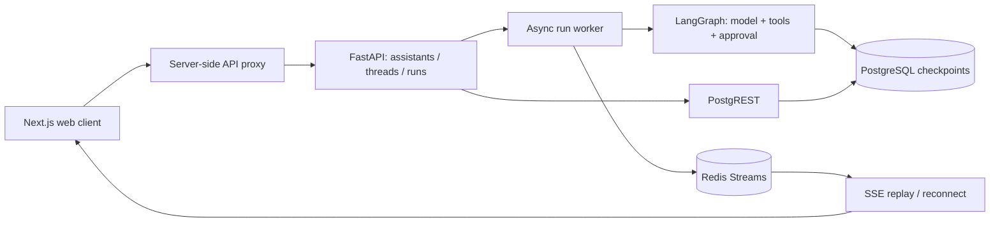
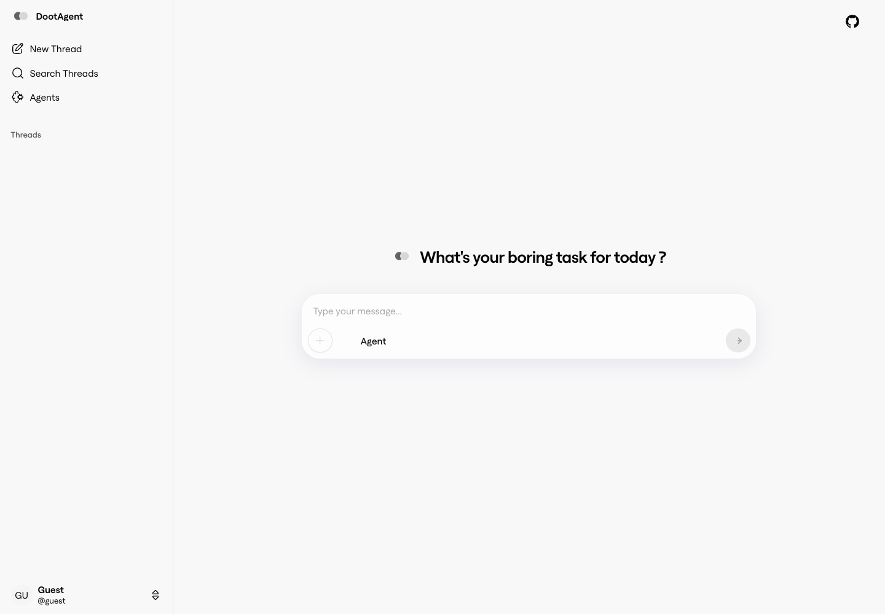

<div align="center">
  
  <h1>Doot</h1>
  <p><strong>Agents that use tools, keep state, and pause for a human decision.</strong></p>
  <p>Built by <a href="https://github.com/Veer376">Aryaveer</a> · Python / FastAPI / LangGraph · React / Next.js</p>
  <p>
    <a href="https://www.dootagent.com">Website</a> ·
    <a href="#demos">Demos</a> ·
    <a href="#run-it-locally">Quickstart</a> ·
    <a href="docs/ARCHITECTURE.md">Architecture</a> ·
    <a href="https://github.com/Veer376/doot-agent-web">Web source</a> ·
    <a href="CONTRIBUTING.md">Contribute</a>
  </p>

[](https://github.com/Veer376/doot-agent/actions/workflows/release-checks.yml)
[](https://github.com/Veer376/doot-agent-web/actions/workflows/release-checks.yml)
[](LICENSE)

</div>

Doot explores the machinery behind an agent product: browser perception and tools, graph execution, persistent conversations, streamed activity, and approval before an action. This repository is the **canonical home for the backend, demos, architecture, and setup**. The [web client](https://github.com/Veer376/doot-agent-web) is maintained separately.

## Demos

### Desktop agent · 32 seconds

The original desktop recording shows Doot returning browser-researched information and continuing a conversation. Electron appears in the recording; this release publishes the backend and web client.

https://github.com/user-attachments/assets/223173bf-3cfc-4686-afcc-3d7ae061ebbf

[Download the original recording](docs/assets/demos/desktop-demo.mp4)

<details>
<summary><strong>Browser actions in a real session · 2 minutes 57 seconds</strong></summary>

The earlier agent navigates a job-search workflow, interacts with page elements, and exposes tool activity while using a real browser session. The recording includes the original 2× playback label.

https://github.com/user-attachments/assets/6b776c79-18d3-4573-8ed4-701b35fa666f

[Download local-execution recording](docs/assets/demos/local-execution-demo.mp4) · [Additional browser-task recording](docs/assets/demos/browser-task-demo.mp4)

</details>

<details>
<summary><strong>Run the current example: inspect → approve → save → reload</strong></summary>

[Watch the approval/resume recording](docs/assets/demos/approval-resume.mp4). This is a live Gemini run on six synthetic support tickets. Two captures of the same thread are joined with the pause omitted. The example was added during release preparation to verify the runtime separately from the older browser workflow.


</details>

## What is worth exploring

| Engineering problem | Doot's approach | Start in the source |
| --- | --- | --- |
| An agent needs a useful view of a changing page | Combine a screenshot with numbered DOM elements; select available tools from page context and prior actions | [Perception](packages/orbit-core/orbit_core/agents/browser_agent/perception.py), [tool registry](packages/orbit-core/orbit_core/agents/browser_agent/toolkit/registry.py) |
| A conversation outlives one request | Store graph checkpoints in PostgreSQL and expose thread state/history through FastAPI | [Checkpointer](packages/orbit-core/orbit_core/clients/checkpointer.py), [thread routes](packages/agent-platform/agent_platform/api/release_threads.py) |
| A user should inspect a write before it happens | Interrupt the graph with proposed content; resume the checkpoint with approve/reject | [Runnable example](packages/orbit-core/orbit_core/agents/showcase_agent.py) |
| A stream disconnects during execution | Store run events in Redis Streams, then replay from an SSE event cursor | [Run worker](packages/agent-platform/agent_platform/worker.py), [run routes](packages/agent-platform/agent_platform/api/routes/runs.py) |
| A UI needs more than final chat text | Surface tool calls, run activity, approvals, and restored conversation state | [Web client and contribution boundary](https://github.com/Veer376/doot-agent-web) |

The browser code and recordings document the original exploration. The quickstart below runs a smaller, reproducible tool/approval example on the same API and checkpointing foundation. [Browser design notes](docs/BROWSER_DESIGN.md) explain the experiments, source map, and remaining gaps.

## Run it locally

**Requirements:** Docker with Compose, Node.js 22, pnpm 9.15.4, and a Google Gemini API key for model calls.

```sh
git clone https://github.com/Veer376/doot-agent.git
cd doot-agent
cp .env.example .env
mkdir -p .doot/reports
# Set GOOGLE_API_KEY in .env with your own key.
docker compose -f compose.showcase.yml up --build
```

In a second terminal:

```sh
git clone https://github.com/Veer376/doot-agent-web.git
cd doot-agent-web
cp .env.local.example .env.local
corepack pnpm install --frozen-lockfile
corepack pnpm dev --hostname 127.0.0.1
```

Open **http://127.0.0.1:3000** and ask:

> Inspect the support tickets, summarize category and priority counts, and save a concise triage report. Explain what should be addressed first.

Review the proposed report, then approve or reject the write. An approved report appears in `.doot/reports/triage.md` in the backend checkout. Reload the conversation to inspect its persisted history. Provider calls use your account.

Check startup without a model call:

```sh
curl --fail http://127.0.0.1:5000/
python3 scripts/smoke_api.py
```

The local profile binds the API to localhost, uses a fixed demo identity, and keeps databases inside the Compose network. Use it on your own machine. Stop with `docker compose -f compose.showcase.yml down`; named volumes retain data. See [Setup & troubleshooting](docs/DEVELOPMENT.md) for native development, reset steps, configuration, and build commands.

## How execution fits together



The worker runs in the API process. Checkpoints persist independently, while event/run metadata has a 24-hour retention window and each stream targets approximately 5,000 events. API restarts do not automatically restart unfinished runs. [Architecture](docs/ARCHITECTURE.md) walks through an approval and lists the supported API.

## Website and project map

[](https://www.dootagent.com)

The website is the deployed web interface; the local quickstart is the reproducible evaluation path. The preview above links to the site.

| Location | Purpose |
| --- | --- |
| [doot-agent](https://github.com/Veer376/doot-agent) | Canonical backend, demos, docs, tests, and local stack |
| [doot-agent-web](https://github.com/Veer376/doot-agent-web) | React/Next.js UI, proxy, and web build instructions |
| `packages/orbit-core` | Agent graphs, model adapters, browser utilities, and database clients |
| `packages/agent-platform` | API, graph loading, thread storage, and run transport |
| `examples` / `tests/release` | Reproducible fixture and deterministic release checks |
| `packages/doot-local` | Later local-system/Aegra experiments, retained with their own tests |
| [Historical lab notes](docs/history/lab-architecture.md) | Original browser-design rationale, migrated from the retired lab |

## Contributing and verification

Start with [CONTRIBUTING.md](CONTRIBUTING.md): setup, a narrow first change, test boundaries, and review expectations. [Reproducible verification](docs/VALIDATION.md) separates automated checks, recorded live behavior, and open engineering gaps. Report a reproducible issue using the repository templates. For credentials or authorization problems, use [SECURITY.md](SECURITY.md).

```sh
uv sync --frozen
uv run pytest
python3 scripts/check_docs.py
```

## Authorship and license

I built Doot's agent experiments, API/storage integrations, model adaptations, and web extensions across the retained development history. The UI extends LangChain's [Open Agent Platform](https://github.com/langchain-ai/open-agent-platform). Backend runtime/service portions are adapted from LangChain code, and browser utilities derive from [browser-use](https://github.com/browser-use/browser-use).

This backend is **source-available under Elastic License 2.0**; the web client retains its MIT license. [NOTICE](NOTICE.md) records the upstream boundaries. Original development history is preserved; removal of committed credentials and unlicensed font assets rewrote affected commit IDs. See [asset provenance](docs/PROVENANCE.md) for the migrated demos and lab material.
