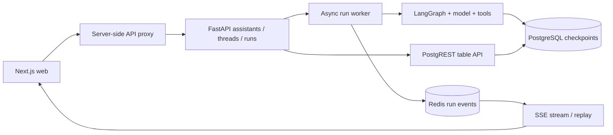

# Doot — a stateful agent backend

A personal agent engineering project by [Aryaveer](https://github.com/Veer376): a custom FastAPI API, LangGraph agents, PostgreSQL checkpoints and a Redis event transport, paired with a [Next.js web client](https://github.com/Veer376/doot-agent-web).

**Status:** engineering showcase. The supported release path runs locally with your own model key. It is not a hosted service or a complete replacement for LangGraph Platform.

<!-- demo:start -->
[Watch the original browser-agent demo](https://github.com/Veer376/doot-agent-web/blob/main/public/dootagent-demo.mp4). This historical clip shows the earlier browser-agent workflow. The ticket-triage example below is a separate release-validation path.
<!-- demo:end -->

## What to look at

- A graph calls tools, streams its work, pauses for human approval, then resumes from a PostgreSQL checkpoint.
- The API exposes a documented subset of LangGraph SDK-compatible assistant, thread and run routes.
- Run events use Redis Streams, with cursors for reconnect/replay. Run records expire after 24 hours; a stream retains at most 5,000 events.
- The web client shows the conversation, tool activity and approval UI. Reloading a completed thread restores persisted state.

The bundled example reads a synthetic support-ticket CSV, calculates counts and asks permission before saving a Markdown report. **This release example and the Redis Streams lifecycle were added during release preparation.** Earlier custom API, browser-agent and local-agent work remains in Git history and source; it is not all covered by the supported quickstart.

## Run backend + web

Requirements: Docker Compose; Node.js 22; pnpm 9.15.4; one Google Gemini API key. Model calls use your provider account and may incur charges.

```sh
git clone https://github.com/Veer376/doot-agent.git
cd doot-agent
cp .env.example .env
# Set GOOGLE_API_KEY in .env, then:
docker compose -f compose.showcase.yml up --build
```

In another terminal:

```sh
git clone https://github.com/Veer376/doot-agent-web.git
cd doot-agent-web
cp .env.local.example .env.local
corepack pnpm install --frozen-lockfile
corepack pnpm dev --hostname 127.0.0.1
```

Open http://127.0.0.1:3000. Ask: **“Inspect the support tickets, summarize the category and priority counts, and save a concise triage report. Explain what should be addressed first.”** Review the requested write, then approve or reject it. Approved output is written to `.doot/reports/triage.md` in the backend repository.

Only the web and API ports are published, bound to localhost. The local profile supplies a fixed demo user; it is **not multi-user authentication** and must not be exposed publicly. PostgreSQL/PostgREST/Redis stay inside the Compose network. Stop with `docker compose -f compose.showcase.yml down`. To reset demo data, explicitly remove the `doot-data` and `doot-events` volumes.

For native development, see [Development](docs/DEVELOPMENT.md). [Supported API and limitations](docs/ARCHITECTURE.md).

## Architecture



Read `worker.py`, `api/routes/runs.py`, and `agents/showcase_agent.py` to follow the supported path. The run worker is a background task in the API process, **not a durable distributed job queue**. Restarting the API does not automatically resume unfinished work; persisted graph checkpoints remain available. Redis retains event/run metadata for the retention window.

## My work and upstream foundations

I developed Doot's custom API/storage integration, browser-agent experiments, model adapters and web extensions over the project's commit history. The web client started from LangChain's [Open Agent Platform](https://github.com/langchain-ai/open-agent-platform); it is not a from-scratch UI. My changes include conversation/tool presentation, model controls, run reconnection, local-runtime connections and approval interfaces.

Some backend API/service code is adapted from LangChain's LangGraph server/runtime code. The vendored browser utilities are derived from [browser-use](https://github.com/browser-use/browser-use). See [NOTICE](NOTICE.md) for attribution and license boundaries. This backend is **source-available under Elastic License 2.0**; do not describe the entire repository as MIT-licensed or OSI open source.

## Boundaries

- The older `langgraph.json` graph set, Kubernetes/cloud deployments and newer `doot-local` / Aegra experiments are retained as historical/experimental work. They are not the release quickstart.
- Arbitrary shell access, browser automation, external MCP accounts, billing, cron and production multi-tenancy are outside the supported example.
- Model output can be wrong. The report tool exposes the proposed content and requires approval; this is not an operating-system sandbox.
- Existing development commits are preserved. Credential and unlicensed-font removal rewrote affected commit IDs; history is not squashed.

## Validation

`uv sync --frozen && uv run pytest` runs the release tests. CI checks the backend tests and the web repository runs a separate TypeScript check and build. Live provider checks are recorded separately from deterministic tests. See [release validation](docs/VALIDATION.md).
